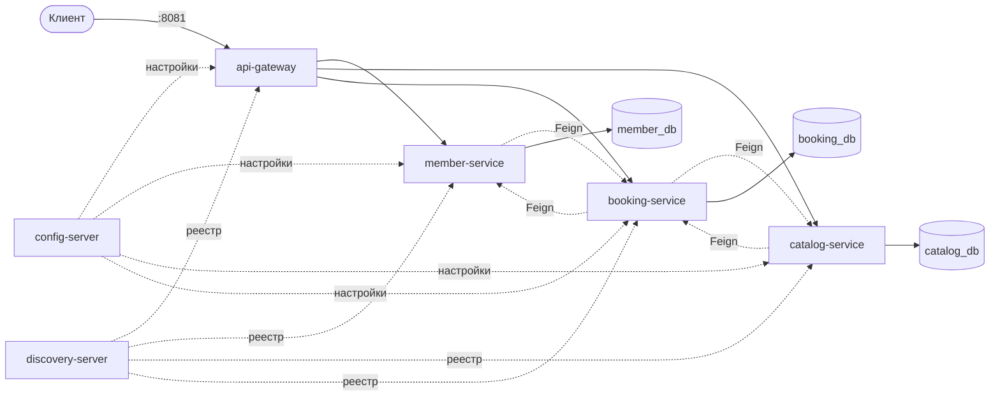

# SportClub

Backend-система управления спортивным клубом на микросервисах (лабораторная работа №2: разбиение монолита из
лабораторной №1 на сервисы).

**Стек:** Java 21, Spring Boot 4, Spring Cloud (Config Server, Eureka, Gateway, OpenFeign, Resilience4j),
Spring Data JPA, Spring Data R2DBC (Reactor), PostgreSQL, Flyway, springdoc-openapi, JUnit 5, Testcontainers,
JaCoCo, Maven, Docker Compose.

## Архитектура



| Сервис | Ответственность | Технологии | БД |
|---|---|---|---|
| `config-server` | централизованная конфигурация (`config-repo/`, native-профиль) | Spring Cloud Config | — |
| `discovery-server` | реестр сервисов, дашборд на `:8761` | Eureka Server | — |
| `api-gateway` | единая точка входа, маршрутизация `lb://`, сквозной `X-Request-Id`, общий Swagger UI | Spring Cloud Gateway (WebFlux) | — |
| `member-service` | участники, тарифы, абонементы | Reactor (WebFlux) + **Spring Data JPA** | `member_db` |
| `catalog-service` | направления, тренеры, занятия | Reactor (WebFlux) + **Spring Data R2DBC** | `catalog_db` |
| `booking-service` | записи участников на занятия | Spring MVC + Spring Data JPA | `booking_db` |

У каждого сервиса своя БД (database per service), прямых обращений к чужим БД нет; внешних ключей между сервисами нет,
существование участника или занятия проверяется вызовом сервиса.

Общие модули и конфигурация: родительский `pom.xml` (версии, JaCoCo), `config-repo/` (настройки всех сервисов),
`docker/Dockerfile` (один параметризованный образ для всех модулей), `scripts/smoke-test.sh` (сквозная проверка стенда).

### Взаимодействие сервисов

Вызовы между сервисами выполняются через **OpenFeign** по имени сервиса из Eureka (клиентская балансировка
Spring Cloud LoadBalancer). Внутренний API находится под `/internal/**`, через gateway он **не публикуется**
(ответ 404) и доступен только внутри docker-сети.

| Кто вызывает | Что вызывает | Зачем |
|---|---|---|
| booking → member | `GET /internal/members/{id}`, `GET /internal/members/{id}/coverage?date=` | активность участника и действующий абонемент на дату занятия |
| booking → catalog | `GET /api/classes/{id}` | время начала и вместимость занятия |
| member → booking | `GET /internal/bookings/member/{id}/exists` | нельзя удалить участника, у которого есть записи |
| catalog → booking | `GET /internal/bookings/class/{id}/booked-count`, `DELETE /internal/bookings/class/{id}` | проверка вместимости при уменьшении и очистка записей удалённого занятия |

### Отказоустойчивость (Circuit Breaker)

Каждый Feign-клиент обёрнут в Resilience4j Circuit Breaker (`spring.cloud.openfeign.circuitbreaker.enabled`),
параметры лежат в `config-repo/application.yml` и общие для всех сервисов:

| Параметр | Значение |
|---|---|
| Таймаут соединения / чтения | 1 с / 2 с, одна повторная попытка через 200 мс при сетевом сбое |
| Окно / минимум вызовов | последние 10 вызовов, оценка с 5-го |
| Порог сбоев | 50 % — цепь размыкается |
| Время в разомкнутом состоянии | 10 с, затем 3 пробных вызова (half-open) |
| Не считается сбоем | ответы 4xx (`FeignClientException`): 404, 409 — это ответ сервиса, а не его отказ |
| Общий лимит вызова | 5 с (TimeLimiter) |

При отказе зависимости срабатывает `FallbackFactory`: клиент получает понятный **503** с сообщением
«Сервис … временно недоступен, повторите запрос позже», а не 500 и не зависший запрос.

## Запуск

```bash
cp .env.example .env        # необязательно: значения по умолчанию уже заданы в docker-compose.yml
docker compose up --build
```

Первая сборка занимает несколько минут (Maven внутри образа). Сервисы стартуют по цепочке с проверками здоровья:
БД → config-server и discovery-server → бизнес-сервисы → gateway. Готовность стенда — `docker compose ps`
(у всех `healthy`).

| Что | Адрес |
|---|---|
| API (через gateway) | http://localhost:8081/api |
| Swagger UI всех сервисов | http://localhost:8081/swagger-ui.html |
| Eureka (дашборд) | http://localhost:8761 |

Наружу опубликованы только gateway и Eureka; сервисы, config-server и базы данных доступны только внутри сети compose.
Для отладки порты можно открыть на localhost:

```bash
docker compose -f docker-compose.yml -f docker-compose.dev.yml up --build
# config-server :8888, member :8082, catalog :8083, booking :8084, БД :5433/:5434/:5435
```

Остановка: `docker compose down` (добавьте `-v`, чтобы удалить данные БД).

### Сквозная проверка стенда

```bash
./scripts/smoke-test.sh            # по умолчанию http://localhost:8081
```

Скрипт проходит весь сценарий: участник → тариф → абонемент → направление → тренер → занятие → запись (201, повтор 409,
неизвестное занятие 404), проверяет маршруты, закрытость `/internal/**`, запрет удаления участника с записями,
каскадную очистку записей при удалении занятия и заголовок `X-Request-Id`. Этот же скрипт запускается в CI.

### Переменные окружения

Настройки читаются из `config-repo/` (Config Server), чувствительные значения подставляются из переменных среды.

| Переменная | По умолчанию | Где используется | Назначение |
|---|---|---|---|
| `GATEWAY_PORT` | `8081` | compose | порт gateway на хосте |
| `EUREKA_PORT` | `8761` | compose | порт Eureka на хосте |
| `MEMBER_DB_PASSWORD`, `CATALOG_DB_PASSWORD`, `BOOKING_DB_PASSWORD` | = имя сервиса | compose | пароли баз данных |
| `CONFIG_URL` | `http://localhost:8888` | все клиенты | адрес Config Server |
| `EUREKA_URL` | `http://localhost:8761/eureka/` | все клиенты | адрес Eureka |
| `SERVER_PORT` | `8080` (config: `8888`, eureka: `8761`) | все | порт приложения |
| `DB_URL`, `DB_USERNAME`, `DB_PASSWORD` | `jdbc:postgresql://localhost:543x/<db>` | member, booking, catalog (Flyway) | JDBC-доступ к БД |
| `R2DBC_URL` | `r2dbc:postgresql://localhost:5434/catalog_db` | catalog | реактивное подключение к БД |
| `CONFIG_REPO_PATH` | `file:../config-repo` | config-server | каталог с настройками |

### Локальный запуск без Docker

Нужны PostgreSQL на портах 5433–5435 (см. `docker-compose.dev.yml`) и запуск в порядке:
`config-server` → `discovery-server` → остальные, например `./mvnw -pl member-service spring-boot:run`.

## Тесты

```bash
./mvnw verify                                  # все модули
./mvnw -B -pl booking-service -am verify       # один модуль
```

Нужен запущенный Docker (интеграционные тесты поднимают PostgreSQL через Testcontainers).
JaCoCo проверяет покрытие строк **по каждому модулю**: сборка падает при покрытии ниже 70 %.
Отчёт: `<модуль>/target/site/jacoco/index.html`. Модули `config-server` и `discovery-server` не содержат своей логики
(только конфигурацию и стартеры), поэтому проверка в них отключена (`jacoco.skip`).

| Модуль | Что покрыто |
|---|---|
| `member-service` | юнит-тесты сервисов, `PageQuery`, клиент и fallback к booking; интеграционные тесты REST API на Testcontainers |
| `catalog-service` | юнит-тесты на `StepVerifier` (R2DBC), валидация сущностей, интеграционные тесты `WebTestClient` + Testcontainers |
| `booking-service` | юнит-тесты `BookingService` с моками портов; интеграционные тесты, включая **конкурентные записи**; реальные Feign-клиенты против HTTP-заглушки; тесты Circuit Breaker (разрыв, восстановление, 4xx не считаются сбоем) |
| `api-gateway` | `RequestIdFilter` |
| весь стенд | `scripts/smoke-test.sh` в CI (`docker compose`) |

## Модель данных

| Сущность | Сервис | Связи |
|---|---|---|
| `Member` (участник) | member | 1—N `Subscription` |
| `MembershipPlan` (тариф) | member | 1—N `Subscription` |
| `Subscription` (абонемент) | member | N—1 `Member`, N—1 `MembershipPlan` |
| `Discipline` (направление) | catalog | N—M `Trainer`; 1—N `TrainingClass` |
| `Trainer` (тренер) | catalog | N—M `Discipline` (`trainer_disciplines`); 1—N `TrainingClass` |
| `TrainingClass` (занятие) | catalog | N—1 `Trainer`, N—1 `Discipline` |
| `Booking` (запись) | booking | **Many to Many с доп. полями** `booked_at`, `status`, `note` между `Member` и `TrainingClass` |

Связи внутри сервиса — настоящие внешние ключи. Связь через границу сервисов (`Booking` → участник и занятие)
хранится как идентификаторы без FK. Схемы создаются миграциями Flyway (`V1__init_schema.sql` в каждом сервисе),
все enum хранятся в БД строками (`CHECK`).

## REST API

Весь API доступен через gateway по префиксу `/api`:

| Путь | Сервис |
|---|---|
| `/api/members`, `/api/plans`, `/api/subscriptions` | member-service |
| `/api/trainers`, `/api/disciplines`, `/api/classes` | catalog-service |
| `/api/bookings`, `/api/classes/{id}/bookings` | booking-service |

Маршрут `/api/classes/{id}/bookings` принадлежит booking-service, хотя начинается с префикса catalog-service:
правило с повышенным приоритетом стоит раньше `/api/classes/**`.

Полный CRUD, коды ответов 200/201/204/400/404/409 (а также 422 — нарушено бизнес-правило, 503 — зависимость недоступна).
Ошибки возвращаются JSON с читаемым сообщением (`GlobalExceptionHandler` в каждом сервисе). Entity и DTO разделены.
Документация OpenAPI всех сервисов собрана в одном Swagger UI: http://localhost:8081/swagger-ui.html.

### Пагинация

Размер страницы ограничен **50** во всех сервисах.

- **С общим количеством** — большинство списков: `GET /api/members?page=0&size=20&sort=lastName,desc`;
  общее число записей в заголовке `X-Total-Count`.
- **Бесконечная прокрутка без total** — `GET /api/classes` возвращает `{content, page, size, hasNext}`;
  запрос `count(*)` не выполняется (читается на одну запись больше, чтобы определить `hasNext`).

## Транзакции и согласованность данных

В монолите составные операции были одной ACID-транзакцией. После разбиения транзакция не может охватить
несколько сервисов, поэтому каждая операция разделена на **локальную транзакцию** внутри одного сервиса и
сетевые проверки/действия вне неё.

### Локальные транзакции

1. **Запись на занятие** — `POST /api/bookings`, `BookingService.book` (booking-service).
   Сначала, *до* транзакции, выполняются вызовы других сервисов (занятие, участник, абонемент): сетевой вызов нельзя
   откатить вместе с БД, и он не должен держать соединение и блокировку. Затем в одной транзакции
   (`TransactionTemplate`): консультативная блокировка занятия `pg_advisory_xact_lock(classId)`, проверка дубликата и
   свободных мест, вставка записи. Блокировка нужна, иначе два параллельных запроса займут последнее место
   (овербукинг). `SELECT … FOR UPDATE`, как в монолите, невозможен: строка занятия лежит в БД другого сервиса.
   Блокировка снимается автоматически по окончании транзакции; записи на разные занятия друг другу не мешают.
   Поведение доказано тестом на 6 параллельных запросах на единственное место.
2. **Оформление абонемента** — `POST /api/subscriptions`, `SubscriptionService.purchase` (member-service).
   Просроченные абонементы переводятся в `EXPIRED`, вычисляется дата начала (продление после действующего) и создаётся
   новый. Участник блокируется `PESSIMISTIC_WRITE`: параллельные покупки не получат одинаковые даты, откат не оставляет
   частичных изменений.
3. **Сохранение тренера** — `POST/PUT /api/trainers`, `TrainerService` (catalog-service, R2DBC `@Transactional`).
   Записываются две таблицы: `trainers` и `trainer_disciplines`; без транзакции сбой оставил бы тренера без направлений.

### Согласованность между сервисами (eventual consistency)

Операции, затрагивающие данные двух сервисов, не атомарны. Принятые компромиссы:

| Операция | Как устроена | Возможная неконсистентность |
|---|---|---|
| Удаление участника | member-service спрашивает booking-service, есть ли записи; если есть — **409** | Между проверкой и удалением может появиться запись (check-then-act). Окно очень мало, а при попытке записи удалённого участника booking-service получит 404 |
| Удаление занятия | занятие удаляется в catalog, затем best-effort `DELETE` записей в booking | При сбое записи остаются «осиротевшими»: они безвредны, так как booking-service не покажет и не создаст записи для несуществующего занятия. Обратный порядок хуже: при сбое удаления занятия записи уже потеряны |
| Уменьшение вместимости | catalog спрашивает у booking число записей; если записей больше — **409** | Запись, пришедшая между проверкой и сохранением, может превысить новую вместимость |
| Недоступность зависимости | Circuit Breaker + fallback → **503** | Операция не выполняется, данные не меняются |

Паттерны распределённых транзакций (saga, outbox) не применялись сознательно: масштаб системы не оправдывает их
сложность, а описанные допущения безопасны.

## CI

`.github/workflows/ci.yml` на каждый push и pull request запускает:

1. **`verify`** — матрица по модулям (`config-server`, `discovery-server`, `api-gateway`, `member-service`,
   `catalog-service`, `booking-service`): `./mvnw -pl <модуль> -am verify` (тесты + проверка покрытия 70 %),
   отчёт JaCoCo загружается как артефакт.
2. **`e2e`** — поднимает весь стенд через `docker compose up --wait` и запускает `scripts/smoke-test.sh`.

## Git-flow

Разработка ведётся в feature-ветках (`feature/*`) от `develop`, коммиты — по Conventional Commits,
слияние pull request в `develop` — «Create a merge commit».
